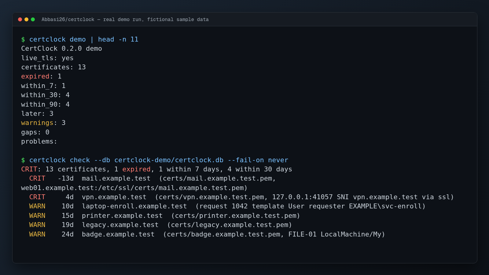

# Demo screenshot



`demo.png` (1600x900) is the unedited terminal output of a real demo run, rendered to an image on 2026-11-03. All hosts, users, devices and files in it are fictional sample data that ships with this repository. No network service or real system was involved.

Setup: pip install -e ".[dev]".

Commands, in the order shown in the image:

```text
$ certclock demo | head -n 11

$ certclock check --db certclock-demo/certclock.db --fail-on never
```

Pipes such as `head`, `grep` or `sed` in the commands above only shorten the output so it fits on one screen. They are part of the shown command.
